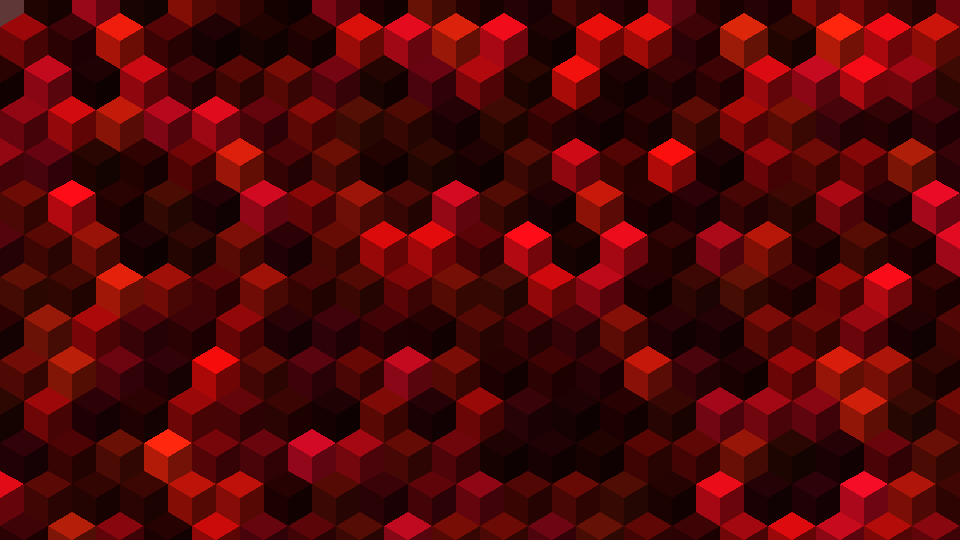

Cuby
====
> A screensaver made of animated isometric cubes.

[](https://github.com/CostardRouge/Cuby/actions/workflows/ci.yml)



Cuby fills the window with a grid of blocks and reveals them in waves: each
wave starts from an edge (or the center), sweeps across the screen with a
fade, rebound or slide effect, pauses, then a new wave with a fresh color
scheme starts over the previous one. Hovering the mouse highlights blocks.

### Requirements

* A C++17 compiler (GCC 9+, Clang 10+, MSVC 2019+)
* CMake 3.16+
* [SDL2](https://www.libsdl.org/) 2.0.18+ and [SDL2_ttf](https://github.com/libsdl-org/SDL_ttf)

| Platform | Install the dependencies with |
| --- | --- |
| Debian / Ubuntu | `sudo apt install cmake libsdl2-dev libsdl2-ttf-dev` |
| Fedora | `sudo dnf install cmake SDL2-devel SDL2_ttf-devel` |
| macOS (Homebrew) | `brew install cmake sdl2 sdl2_ttf` |
| Windows (vcpkg) | `vcpkg install sdl2 sdl2-ttf` then configure with `-DCMAKE_TOOLCHAIN_FILE=<vcpkg>/scripts/buildsystems/vcpkg.cmake` |

### Building

```sh
cmake -S . -B build -DCMAKE_BUILD_TYPE=Release
cmake --build build --parallel
./build/cuby
```

The `Makefile` wraps the same steps: `make`, `make run ARGS="--color blue"`,
`make test`, `make debug` (sanitizers + warnings as errors) and `make clean`.

`cmake --install build` installs the binary and the font; the font is also
found automatically next to the executable, in `Assets/` of the source tree
and in the current directory.

### Usage

```
cuby [options]

      --width <px>           window width in pixels (default 1024)
      --height <px>          window height in pixels (default 600)
  -f, --fullscreen           start in (borderless) fullscreen
  -b, --block-size <px>      size of one block in pixels (default 40)
      --gap <px>             spacing between blocks in pixels (default 0)
  -s, --speed <factor>       animation speed multiplier (default 1.0)
  -c, --color <mode>         rainbow, groups, random, mono or a color name (default groups)
  -o, --origin <edge>        top, bottom, left, right, center or random (default random)
  -m, --mode <mode>          apparition: fade, rebound, slide or instant (default fade)
      --shape <shape>        cube or flat (default cube)
      --fps-limit <n>        cap the frame rate, 0 = unlimited (default 60)
      --no-vsync             do not synchronise rendering with the display
      --show-fps             show the frame counter at start-up (F1 toggles it)
      --hide-cursor          hide the mouse cursor over the window
      --exit-on-input        quit on any key or mouse activity (screensaver behaviour)
  -d, --duration <seconds>   quit after this many seconds (default 0 = never)
      --seed <n>             seed the random generator for a reproducible run
      --font <path>          TrueType font used for the on-screen text
      --screenshot <file>    save the last frame as a BMP image when quitting
  -h, --help                 show this help and exit
  -v, --version              show the version and exit
```

Color names: `red orange yellow green cyan blue purple pink white`.

Examples:

```sh
cuby --fullscreen --hide-cursor --exit-on-input        # behave like a real screensaver
cuby --color rainbow --mode rebound --origin center    # colorful, bouncy
cuby --shape flat --color red --block-size 32          # the original look
cuby --duration 5 --screenshot shot.bmp                # render 5 seconds and keep the last frame
```

### Keys

| Key | Action |
| --- | --- |
| `Esc` / `Q` | quit |
| `Space` / `P` | pause |
| `F1` | toggle the frame counter |
| `F11` / `F` | toggle fullscreen |
| `C` | next color mode (rainbow, groups, random, mono) |
| `M` | next apparition mode (fade, rebound, slide, instant) |
| `O` | next origin (top, right, bottom, left, center, random) |
| `S` | toggle cube / flat blocks |
| `R` | restart the current wave |
| `+` / `-` / mouse wheel | change the animation speed |

### Testing

```sh
ctest --test-dir build --output-on-failure
```

The unit tests cover the option parser, the color maths and the palette. The
smoke tests start the real program for a fraction of a second with SDL's
`dummy` video driver, so they run without a display (CI runs them under
AddressSanitizer and UndefinedBehaviorSanitizer on Linux, and on macOS).

### Project layout

```
src/        application sources (App, Display, Grid, Palette, Overlay, Settings)
tests/      unit tests
Assets/     font and images
CMakeLists.txt, Makefile
```

### Release history

* **v0.2** - SDL2 port, isometric cubes, command-line options, runtime keys, tests and CI
* **v0.1** - original SDL 1.2 prototype

### Author
> Steeve Pommier

* [Blog](http://costardrouge.eu)
* [Github](https://github.com/CostardRouge)
* [Twitter](https://twitter.com/BlousonRouge)
